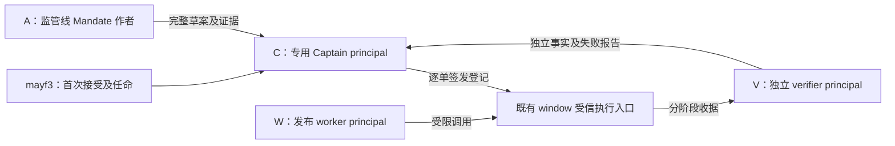
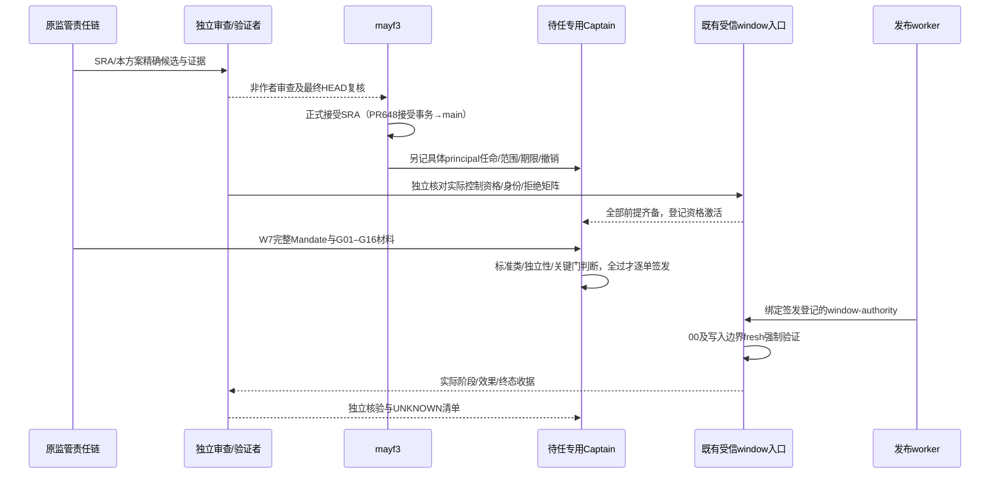

# Release Captain 受托核定方案（Owner V2 补充①响应稿）

```text
STATUS = PROPOSAL_ONLY_NOT_APPOINTMENT
SPEC_GOVERNANCE_MODE = PREFLIGHT
AUTHORITY_ACTION = REUSE
PLAN_LEVEL = BRIEF
ASSURANCE_LEVEL = DURABLE
ROUTE_STAGE = AUTHORITY_AUTHORING
AUTHORITY_ACCEPTED_IN_BASE = NOT_APPLICABLE
IMPLEMENTATION_AUTHORITY = none
CAPTAIN_APPOINTED_BY_THIS_TASK = NO
DELEGATION_EFFECTIVE_BY_THIS_TASK = NO
OPERATION_ALLOWED_NOW = NO
MERGE_ALLOWED_BY_THIS_TASK = NO
```

**建议采用四个不同 principal：监管线 Mandate 作者、发布 worker、独立 verifier、独立专用 Release Captain。首任推荐为新核定的专用 Captain principal，不推荐直接采用监管会话 uid502。** 本文提供可供 mayf3 核定的身份方案、登记字段与执行控制条件，没有替任何角色生成真实身份、任命、Grant 或窗口授权。

本轮 `REUSE` 仅指依现有 Owner 任务制作非权威提案；不声称 SRA 已接受，也不以此路线授权身份/权限实现。将方案转为生效规则属于 SRA 的后续 docs-first 接受事务；控制适配与生产激活各自重新 PREFLIGHT，涉及身份/授权的工作按 CONTROLLED 处理。

## 0. 授权、坐标和适用边界

任务来源是 [BRIEF 原件快照](docs/reports/captain-design-20261107/BRIEF-CAPTAIN-DESIGN.source.md)。Owner 原文见 [只读选择记录](docs/reports/captain-design-20261107/owner-selected-records.json)：`$.rulings[id=owner-20261107-preauth-v2-supplement]`，canonical SHA256=`6b734043df5d6f0314ac426450ad449a1c0afd601721aa27a16ef570cf0bbada`。其中①明确 uid502 仅候选、台账不能替代身份与委托；②明确首次由 mayf3 接受，不能循环授权；③保留 W7 全部门和 UNKNOWN；④要求复用现行体系。本文没有把台账快照当任命依据。

权威基线为 `mayf3/dsh-agent-core main@f6e332d7568b01c5253618449bfef5839102c851`。依 [local README](.agents/local/README.md)、[Architecture](docs/AGENT_CORE_PRODUCT_ARCHITECTURE_V1.md)、[D-008 §22](docs/decisions/AGENT_WORKSPACE_SESSION_MODEL_V3.md#22-security-domain-与来源边界)、[Hardening Program §0.1](docs/specs/AGENT_CORE_HARDENING_PROGRAM_V1.md)、[Credential Metadata §2](docs/specs/AGENT_CORE_CREDENTIAL_METADATA_RESOLUTION_V1.md)、[Deployment Control Plane](docs/specs/PRODUCTION_DEPLOYMENT_CONTROL_PLANE_V1.md) 判断：principal/credential/grants 归 Agent，Session 是运行及归因坐标；共享 UID/不同 Session 不自动形成不同安全主体；metadata PRESENT/clientId 不证明 auth-service Principal、Grant 或签发权限。DCP 的 `production_apply_authority: none` 仍有效。

[PR #648](https://github.com/mayf3/dsh-agent-core/pull/648) 在本轮读取时为 open、未合并，head=`61b97d326e337057cd1f71c0a6ff0dc37ab72ec2`。[SRA 草案](https://github.com/mayf3/dsh-agent-core/blob/61b97d326e337057cd1f71c0a6ff0dc37ab72ec2/STANDING-RELEASE-AUTHORIZATION-V1-DRAFT.md) SHA256=`5c1bb2567bd2ca04a2743d6c871934204fe511023aec340058f02df0477531e2`，仅为提案输入。本文细化其 §1/2/6，不修改 SRA-C-*、accepted authority 或既有生产禁令。SRA 的 uid502 首任候选与本文推荐不同，是待审提名的比较，不是两份已接受权威的冲突；后续接受事务须明确唯一采用方案，并将 SRA 候选说明与补充②首次接受者同步，不能让两种可独立生效解释并存。

精确 commit/blob/SHA256 与观察时间见 [source-provenance](docs/reports/captain-design-20261107/source-provenance.json)。没有访问生产 auth-service、credential store、生产 runtime、锁或状态库。

## 1. 职责分离结构与推荐

### 1.1 四 principal 角色图



| 角色 | 职责 | 禁止兼任及权力边界 |
|---|---|---|
| A：Mandate 作者／监管线 | 汇总 accepted authority、精确 tuple、effects、回退、各门证据；拟定 Mandate；记录缺口 | 不作本单 C、W、V；不能把自己审稿/PASS 写成签发或接受；监管审查若实质改写 Mandate，按作者计算 |
| W：发布执行者／worker | 仅调用已准入入口，持本单唯一 writer 身份与本人 mutex；保全阶段、真实 rc、UNKNOWN 和收据 | 不作本单 A、C、V；不能自签、自验、自增 attempts、重放未知写入、夺锁或更换运行身份 |
| V：独立审查／验证会话 | 独立核验技术资格和阶段证据、实际 readback、负向拒绝、终态；声明作者独立性 | 不作本单 A、W、C，也不实质创作候选/installer 后验证自己；可以建议修复，实质参与后须另换 verifier |
| C：Release Captain | 核任命/范围/时效、独立性及 SRA G01–G16 材料；签发逐单 Mandate；依据独立事实判定闭环或 STOP | 不作本单 A、W、V，不是候选/installer 实质作者；不得自任、自接受首次 SRA、转委托、补造验证、豁免门、扩大范围 |

冲突矩阵针对**同一单发布**，X 表示不得用同一 principal 承担；新开同 principal 的 Session 不消除冲突。

| 同一 principal | A 作者 | W writer | V verifier | C Captain |
|---|---|---|---|---|
| A 作者 | — | X | X | X |
| W writer | X | — | X | X |
| V verifier | X | X | — | X |
| C Captain | X | X | X | — |

Owner 是图外现有授权者。首次 SRA 起草与独审完成后由 mayf3 接受，再由 mayf3 任命 C；不从 Captain 资格反推接受者权限。独立 verifier 提供证据，Captain 的核验和签发不能替代这项独立验证。本轮文档的协作审查会话也不因此成为生产 V。

三 principal 方案通常需合并 A+C、W+C 或 V+C：会形成自审签发、执行自签或签发者自验，均不采用。本提案四主体的约束较 Owner “不得同一身份完成全链”的最低要求更严格，是待核定的职责分离方案，未宣称 Owner 已逐对禁止全部兼任。

### 1.2 推荐 A 与候选 B（uid502）比较

| 比较项 | 推荐 A：独立专用 Captain principal | 候选 B：监管会话 uid502 |
|---|---|---|
| 具体身份 | 专用逻辑候选 `release-captain-agent-core-20261107`，真实 auth-service ID/session 待合法核定 | 仅有 OS UID 和监管台账归属，真实 auth-service principal/session 委托未证 |
| 作者相邻性 | 不参与候选/installer/Mandate 实质创作，也不担任监管审稿或 V | 监管会话兼任 Mandate 审查者，会先判断/塑造内容再作签发核验，存在作者相邻性；若实质改写则直接成为作者 |
| 签发与验证 | C 与 A/W/V 四个不同 principal，职责清楚 | 若监管审查同时被记为独立 V，则 C/V 冲突；换一个 Session 不解决同主体冲突 |
| 落地成本 | 需合法身份绑定、独立性证明和执行控制资格，不因专用名称降低门槛 | uid502 可方便归因，但当前证据不足以证明身份/权限；不能以成本较低为由直接授予 |
| 结论 | **推荐**；最小化作者相邻性，避免监管意见、签发和验收在同主体闭环 | **不推荐当前直接任用**；只有下列缓解齐备并由 mayf3 明示选择后才可重新核定 |

候选 B 必需缓解清单：①查清其真实 principal/Agent/session/控制者，证明不与 A/W/V 共用 principal 或可代用凭据；②从该单开始前回避监管 Mandate 实质创作、审稿和 V，另指定独立 A 与 V，保存历史参与披露；③已实质参与本单候选/installer/Mandate 的，不通过追认、改名或换 Session 消除，改由其他 C 签发；④独立审查其剩余利益冲突、能力、原监管职责接替人；⑤mayf3 明确任命具体主体、范围、UTC 期限及禁止兼任；⑥与推荐 A 相同的工具级身份、任命、撤销、越界拒绝资格必须通过。只是旁听/阅读不自动构成作者，但其相邻性仍须披露和独立判断，不能自证消除。缓解未齐则不激活 B；推荐 A 的未知也不构成 B 自动递补理由。

## 2. 具体受托 Principal 核定表

以下是拟供登记的**四组三元组**。逻辑候选名是可读标签，不是 auth-service 已有对象或真实 `agt_*` ID；所有未实测的不可变 ID 均保持 `UNRESOLVED_NOT_APPOINTED`，不伪造 UUID、clientId、token 或 sessionId。登记前由既有身份/权限责任方合法核定，四行实际 principal 必须不同。

| 角色及逻辑候选 | 三元组：auth-service Principal / 专用 session / 台账归属 | 身份延续证明要求 | 能力要求 | 拟注册坐标（尚未写入） |
|---|---|---|---|---|
| A `release-mandate-regulator-20261107` | `P_A=UNRESOLVED_NOT_APPOINTED` / 监管 Agent 的精确 `(agentId,sessionId)` / 现有监管任务条目及本单 Mandate authorRef | 受信身份方证明 P_A→Agent→原 session→当前 session；本单 authorRef 与参与历史不可删除 | accepted authority/范围判断、完整 Mandate、effects/preimage/STOP 与证据归因 | 既有 DISPATCH-REGISTRY 的本任务归属 selector（只归属）+ 本单 Mandate/PR author 记录 URL/id/hash |
| W `release-worker-agent-core-w7` | `P_W=UNRESOLVED_NOT_APPOINTED` / worker Agent 精确 `(agentId,sessionId)`、turn/进程绑定 / 既有 W7 worker 条目 | P_W→Agent→worker session→受信调用身份→执行收据；OS UID/PID 另列，不能代替 principal | 已准入入口使用、实际收据消费、单 writer/phase/attempt/安全停止 | 既有 W7 Mandate writerRef、worker归属 selector、执行/互斥与收据坐标 |
| V `release-verifier-agent-core-w7` | `P_V=UNRESOLVED_NOT_APPOINTED` / 独立审查 Agent 精确 `(agentId,sessionId)` / 本单独立审查/Receipt归属 | P_V→独立 Agent→审查 session→归属记录；核对与 A/W/C 及候选作者的冲突 | 独立读原始收据、权限限定的 readback、负向门、UNKNOWN 与停止结论 | 现有 PR review/报告不可变 revision + 本单 verifierRef；权限仅所需验证面 |
| C `release-captain-agent-core-20261107` | `P_C=UNRESOLVED_NOT_APPOINTED` / 独立 Captain Agent 精确 `(agentId,sessionId)` / mayf3 将来的任命登记归属 | auth-service 的真实稳定 Principal（含适用 issuer/tenant）→专用 Agent→本次 session 的受信映射；与 appointmentRef/issuanceRef 一致 | SRA G01–G16、installer/完整闭包/回退/独立性评审、真实入口/收据、scope/时效/撤销、拒签 STOP | PR #648 或其正式接受事务中的 Owner 任命记录 ID/URL/内容hash + 现有台账引用；本单签发记录另设 issuance ID |

每行正式记录还需：真实授权者身份及依据、被授权者不可变 ID、Agent ID、session/turn、控制者及共享凭据声明、OS UID（观察）、权限范围、起止 UTC、撤销来源、受信身份核定收据及独立性声明。台账路径为 Owner 来源记录中已有的 `/Users/yanfenma/Documents/Codex/2026-10-18/zcode-assist/tools/b7ctl/DISPATCH-REGISTRY.json`；应使用稳定记录 ID selector，数组索引只作观察提示。本文不向该文件追加任命，不创建新台账系统。

身份延续建议复用既有 Agent/凭据和 session 机制：同一真实 principal 续开 session，由受信运行时或身份责任方的可验证记录绑定 `(P, agentId, oldSession, newSession, effectiveAt, authorityRef)`，在现有任命链追加映射并独立复核。聊天声明、记忆、UID 相等、同 GitHub login、历史 reviewer_session 或 DISPATCH 归属都不够。若共享同 Agent principal，仅换会话仍是同一身份；若更换真实 principal，则是新任命/替任，不算延续。当前没有核实可供 window 入口消费的跨 session 证明实现；缺证明期间签发资格 NO，不为交接反复请求已决定的范围。

## 3. 授权范围（与 SRA §2 对齐）

| 维度 | 拟授权边界 |
|---|---|
| 仓 | 仅 `mayf3/dsh-agent-core` 的 main 已接受 Contracts 内候选；harness/Node/installer 只是本单完整闭包的精确依赖，不产生其他仓独立发布权 |
| 目标面 | 仅既有、已经合法准入的单一 fleet runtime；每单登记 host identity、launchd domain/label、install root 与生产身份；不能凭本方案补造其当前值或权限 |
| 发布类 | 仅 `STANDARD_RECOVERABLE`：SRA §2 五项全部成立、既有已准入执行入口能强制、完整 Mandate/Runbook、精确 tuple、唯一 writer/独立 verifier、有界窗口/attempts、完整回退与 STOP |
| stage10 | 旧 runtime、workers 与已派发外部操作已终止或有效隔离；到该边界全部适用门通过后才结束停机 containment；只恢复原有合法自然准入；11/12 后续验证仍必需，不能预填 PASS |
| 权力性质 | C 只签发合格的逐单 Mandate，不授予产品接受权、首次 SRA 接受权、任命权或转委托权；既定标准类条件齐备后无需 Owner 逐单重批 |

沿用 SRA §2 排除：bootstrap 后仍需全局暂停；新语义、危险迁移、扩权、跨域或首次新 runtime/目标面；新装/激活 controller、profile、trust root、setuid helper；改变运行身份、认证策略或 Node 架构；无法安全回退或超既定策略的重大风险。另不授予 Secret/Grant 变更、Router 写 Scheduler、清他人 fence/锁、抹掉历史 UNKNOWN、旧业务快照回灌、真实业务重投或来源未知部署追认。发布、业务恢复、控制器/profile 更新保持不同授权和证据主体。

缺 installer 资格、构建兼容或普通证据由原责任链补齐，依赖操作暂停，不能一律改为 WAITING_OWNER；真实越界/新权限/危险迁移/不可安全回退才按 Owner V2 升级。无关 main/commit/session/worker 前移不自动失效已冻结范围，但须核对受影响证据和身份映射。

## 4. 有效期、续任和撤销

建议首任 `validFrom` 为 mayf3 正式任命登记与全部控制/身份资格齐备后的实际激活 UTC，禁止回填；`validUntil=2026-12-07T00:00:00Z`（北京时间 12 月 7 日 08:00，排他上界）。这是建议的明确截止，不声称 Owner 已确认这个时刻；mayf3 若选择不同 UTC，须在正式任命写明。期限不得超过 SRA 自身有效期。若激活已到截止，则不能激活，另行续任。

每单有效区间取 `SRA ∩ appointment ∩ issuance ∩ window`，且每一依赖写入边界 fresh 检查 `validFrom ≤ now < validUntil`、未撤销和范围；签发发生在期限内不能把写入延伸到期外。

续任由 mayf3（或其随后明确授权且范围含续任的主体）在原任命 PR/记录链追加新任命 ID/前任引用、精确 principal/session 映射、新 UTC 期限、能力/独立性/控制资格复核、接受及登记者坐标。无自动续期、无仅改本地 JSON 延长；更换 principal 作为替任。现有登记可引用台账归属，台账不成为独立授权来源。

撤销/缩窄由 mayf3 或原有权任命者在同一链追加 revocation ID、原 appointment ID、作用范围、登记与生效 UTC、真实 actor/授权依据、原因、受影响签发/window 和通知/消费回执；保留历史。执行控制必须读取最新真实撤销状态、检测删改/旧快照及中断，不能仅信调用方给的旧文件。无法 fresh 核验即拒绝新的依赖写入。已在飞操作按原已批准的阶段安全停止/恢复配方处理，保留 phase、mutex、UNKNOWN；撤销本身不授权 kill、回滚、重放、夺锁或由替任追认未知结果。

## 5. 实际工具执行控制与负向资格

### 5.1 现有实现观察与界限

基线 [window_helper_core.py:25](scripts/fleet-window/window_helper_core.py#L25) 的 `validate_authority` 校验必填字段、writer UID 非 root 且匹配、固定旧 SHA、必需 scopes 子集和 UTC window 时效；`authority()`（88–91 行）仅重新读取本地副本及窗口时间。[window_helper.py:5–11](scripts/fleet-window/window_helper.py#L5) 复制输入 JSON、记 hash/argv，没有真实 Captain/任命查验。[executor help](scripts/fleet-window/window-executor-v5.sh#L30) 已明确自写 JSON 不授予权限。当前还有历史旧 SHA pin；不得从源码存在推断其适用于 W7 或已生产准入。

这些路径没有 `sraRevision / appointmentRef / issuerPrincipal / issuanceRef` 的受信校验，没有任命/签发真实性、范围上限或撤销消费。现有 `scope-required ⊆ input-scopes` 不是 `requested-effects ⊆ delegated-scope`。旧 selftest 的缺字段/root writer/窗口过期/缺 scope 负例也不能证明未任命、任命过期或越界 Captain 会被拒。隔离纯函数探针及实际结果将在 [RECEIPT](RECEIPT-CAPTAIN-DESIGN.md) 绑定；不执行 executor 的 `--execute` 或会建立 privileged scratch 的完整 selftest。

**当前结论：Captain 技术准入资格未建立。即使 SRA 已接受、任命已登记，只要本节真实控制资格未通过，仍不得登记 EFFECTIVE 或签发可执行窗口。** 这不阻止本文作为方案交付。

### 5.2 沿用 window-authority JSON 与登记坐标的最小绑定方案

复用现有 Spec/PR、Mandate、Receipt、台账和实际 window 入口，不建审批服务、并行授权库或新产品 protocol。下表是待核定的逻辑绑定要求，字段名为提案，未实现 schema；不生成可执行 authority JSON。每单唯一原件为完整已签 Mandate，其签发记录绑定精确内容，JSON 仅承载执行引用。

| 拟绑定项 | 真实来源和验证要求 |
|---|---|
| `sraRevision` | mayf3 首次接受记录 URL/id、reviewed/final accepted commit、main 可达 Spec path/blob/hash、生效范围/期限；PR open 或 reviewer PASS 不足 |
| `appointmentRef` | mayf3 任命记录 ID/URL、登记内容 hash、accepted SRA revision、真实 P_C、范围/UTC/撤销源、资格回执；读取者核真实授权事件归属及授权者权限，不能用 Agent 经同 GitHub 账号发言冒充 Owner |
| `captainPrincipalRef / sessionBindingRef` | 身份责任方的受信 principal→Agent→签发 session 映射、凭据/caller 真实性；不能接受 JSON 自报 UID/角色名或从 clientId 猜 principal |
| `issuanceRef` | 既有 PR/Mandate 签发登记 ID/不可变内容 hash、真实签发 actor、appointmentRef、完整 Mandate 内容hash、windowID、候选/旧版/installer/harness/Node/闭包/effects、writer/verifier、UTC/attempts、G01–G16 证据与到阶段才取得的 fresh 门 |
| `window-authority` | 保留现有精确状态/身份/时窗字段，绑定上述四项和对应 runbook；requested effects 是 SRA、任命、逐单签发三层允许范围的精确子集，并逐项核排除项，不接受额外 scope |
| `controlRevision / qualificationRef` | 实际执行入口及全部授权检查闭包的 commit/hash、既有准入依据、控制所有者、独立资格/负例回执；拒绝绕开检查直接调用 helper、旧入口或额外 root 命令的路径 |
| `revocationReadbackRef` | 权威源最新 revision/读取时间/真实身份及当前有效状态；每个依赖写入边界重新取证，检测内容改写、回退到旧登记、不可读；不能仅信自报 revocation=false |

受信入口在 stage00、生产 mutex 创建前先验证：①真实 SRA 接受和 mayf3 任命；②C 当前身份及 session 延续、四角色冲突；③上述有效区间及撤销；④精确仓/目标/类/effects/tuple、runbook/门、尝试预算；⑤签发原件、引用和实际执行字节一致。通过后固定本单封印；取得本人 mutex 后、每个依赖写入前重新核时效/撤销/封印和对应 fresh 门。签发前材料门齐，未来门只能写 `REQUIRED_AT_STAGE`；到边界失败必须挡住该阶段，不能靠已有签名越过。

受信读取/验签或现有受保护权限读取机制必须在 worker 可改的 JSON 之外建立真实性。登记 URL、hash 或公开可读文件本身不证明授权；若使用现有受信导入/签名，需要记录已有 trust source、密钥/权限责任者、不可由 worker 替换的验证闭包及最新撤销消费证明。**本轮未证实存在这种可用绑定，不在文档里假定一个“受信 wrapper”已经解决。** 若现有合法入口不能强制，原责任链先提出具体适配缺口并另行获得所需实现/准入授权；不得以本提案安装 controller/profile、trust root、sudoers、setuid helper 或扩 Grant。

失败返回明确拒绝理由与 raw rc，收据绑定控制版本/hash、授权源 selector/revision、observedAtUTC、principal/session、tuple、window/stage、被拒条件、是否发生效果。00 前失败不创建生产 mutex、不读写生产；中途失败不越过下一依赖写入，保全既有 phase/mutex/UNKNOWN，按原批准配方安全停止。不能用拒绝日志推断已派发 child 或远端 effects 已终止。

### 5.3 待执行的负向资格矩阵

所有下列项目均为 **TEST_DEFINITION_ONLY / NOT_EXECUTED_FOR_FUTURE_CONTROL**。先用隔离 fixture/假时钟/零生产 backend；独立 V 绑定实际入口版本、fixture、原始 rc、拒绝点和零效果计数。离线 PASS 不等于生产安装/准入；最终实际工具控制仍需合法资格和独立回执。

| ID | 输入/反例 | 必须拒绝的边界及结果 |
|---|---|---|
| N01 未任命 | SRA 有接受，但 P_C 无任命；仅 uid502、台账归属或自造 appointmentRef | stage00/生产锁前拒绝；没有生产效果 |
| N02 过期 | window 仍有效但 SRA/任命/签发任一过期；含截止等号、未到 validFrom | 拒绝；分阶段假时钟到期也挡下一写入 |
| N03 越界 | 换仓/host/目标面、非标准类、新 runtime/controller/Secret/Grant/extra scope | 拒绝；不能因必需 scopes 仍齐而通过 |
| N04 撤销/旧快照 | 签发后撤销、撤销源不可读/回退、调用者藏旧副本 | 00 或下一写入前拒绝；保留原阶段和 UNKNOWN |
| N05 身份/循环授权 | A/W/V 与 C 同 principal 换 session、无身份延续、候选自接受 SRA/自任 | 拒绝；不从相同 UID/GitHub login 推导授权 |
| N06 内容/入口替换 | 改 Mandate/JSON/installer/闭包/window、登记被编辑、跳过新检查调用旧 helper | 拒绝；旧 hash 或人工 PASS 不能替代当前原件 |
| N07 关键门 UNKNOWN | installer/auth/状态兼容/前态/回退/stage10/verifier 缺材料；未来门到边界未得正证 | 拒绝签发或对应阶段；不预填未来 PASS、不自动签 W7 |
| N08 试次/并发 | 换 windowID 重置已开始 install/bootstrap、第二 writer、跨窗口重用签发 | 拒绝；不夺锁、不因 timeout 推断前次未执行 |

还需正向隔离用例：四真实可验证 fixture 身份、SRA/任命/签发/窗口交集有效、标准 scope/精确 tuple、全部当前门齐，受限假 backend 才可进入允许阶段；证明拒绝并非“永远失败”的空实现。不得用 fixture 身份冒充真实已注册 principal。

## 6. 任命、接受与首单 W7 时序



| 步骤 | 合法授权者/责任者 | 必需登记坐标及不越界条件 |
|---|---|---|
| T0 起草/审查 | 原链依本任务起草，非作者 reviewer 审查 | 本 PR + PR #648 的精确 reviewed head/base、独审/最终 HEAD 记录；不接受、不任命 |
| T1 mayf3 接受 SRA | **mayf3**，依 Owner 补充②现有权限；候选 C 不接受自身权源 | PR #648（或其明确链接的正式接受事务）记录 accepted-by/at、Owner 真实授权事件、reviewed/final accepted head；正式 Spec/发现入口及 main merge receipt。只 merge 草案不足以生效 |
| T2 mayf3 任命 Captain | **mayf3**，T1 的 SRA 不反向授权 T1 | 同一 PR/现有任命链的真实记录 ID/URL/内容hash、SRA revision、§2 完整三元组、§3 scope、§4 UTC/撤销及独立性。台账仅加引用；本轮不写 |
| T3 资格激活 | 依已接受 SRA/任命的现有控制责任者核对，独立 V 出证；C 不自证 | 同链激活 Receipt：T1/T2 refs、实际身份与控制闭包/hash/已有准入依据、N01–N08 资格、当前期限/撤销；全部齐才 EFFECTIVE。没有可用控制则 T3 不成立，T2 不自动激活 |
| T4 W7 首单候选审查/签发 | 激活后的 C 在任命 scope 内；作者 A、writer W、verifier V 分离 | W7 最终 Mandate commit/hash、各角色 refs、精确 tuple/状态/闭包、G01–G16、签发记录 ID/UTC/hash。installer/auth/状态兼容/真实前态/回退/stage10/独立验证任一关键未知，不自动签发；未来 fresh 事实按阶段取得 |
| T5 执行/独立收据 | W 仅依 T4；入口强制；V 独立核验；C 依事实闭环 | authority JSON 封印 + issuanceRef + stage/attempt/mutex/真实 rc/效果与恢复/独立 post-state；自然 HR 无观察仍如实登记；健康不等于业务成功 |

技术资格可在独立合法授权的非生产任务中先准备，但实际激活必须晚于 T1/T2 且所有条件同时有效。T3 不能新授予控制器/生产权限，T4 不能补豁免 T3。本文交付只完成 T0 中的方案，不替后续步骤填日期或状态。

## 7. 开放问题、责任与下一动作

| 问题 | 当前事实/限制 | 原责任链下一动作及阻断范围 |
|---|---|---|
| Q1 四个 auth-service Principal 是否可用且不同 | 未作生产 Auth API/DB/store 读取，真实 ID、状态、scope/Grant、控制者 UNKNOWN | 既有身份责任方在其合法权限内出具脱敏、可验证的 ID/映射/权限收据；metadata/clientId 不等价。阻断任命/激活，不阻断本提案 |
| Q2 专用 Agent/session 和跨 session 身份延续 | D-008 有实体归属，无本任务已核实可供 window 消费的证明链 | 核既有受信机制和权限，填 §2 具体映射；若缺，明确最小机制及另行路线，禁止自行赋身份 |
| Q3 工具端任命/签发/撤销验证 | 当前源码未具备 Captain 准入；未证实受信登记导入或 caller 身份绑定 | 控制责任者提出并资格化最小适配、独立负例/绕行拒绝证据；无证 EFFECTIVE/操作 NO；不默认新建平台 |
| Q4 独立性与 uid502 历史参与 | 监管会话有 Mandate 审查职责；精确参与程度/真实 principal 未证 | 披露实质作者/审查历史，填冲突矩阵；优先独立 C，B 仅按 §1.2 缓解后核定 |
| Q5 SRA 接受与唯一生效文本 | PR648 仍 proposal；尚未首次接受、任命或激活 | mayf3 在后续接受事务明确首任推荐与补充②、正式唯一 Spec/登记链；不以本 PR 代替接受 |
| Q6 明确截止/续任者/撤销消费 | 12月7日 UTC 时刻为本提案建议，实际确认/登记及工具 fresh 消费均未证 | mayf3 正式任命选定 UTC；原链证明生命周期读取和拒绝。到期/不明停依赖写入 |
| Q7 实际 W7 资格与生产前态 | 本轮不重新评估既有 installer 任务，不读生产；它们当前资格/前态 UNKNOWN_FOR_THIS_TASK | 复用原链仍有效证据，只补实际失效门和执行边界 fresh 事实；不能从本文或历史 PASS 自动签 W7 |

上述未知是未来任命/激活/单次操作的依赖，不是虚构的已接受产品语义冲突，也不自动把普通修复升级给 Owner。若发现真实 accepted authority 冲突，停止相关工作并按仓库规则报告；若本任务发生实际交付/验证/出版失败，立即停止后续写操作，保留事实并仅写 `STOPPED-CAPTAIN-DESIGN.md`。完成方案、覆盖回执、独立审查、commit/push 和未合并 PR 后停止，不延伸到任命、接受、签发或生产操作。
