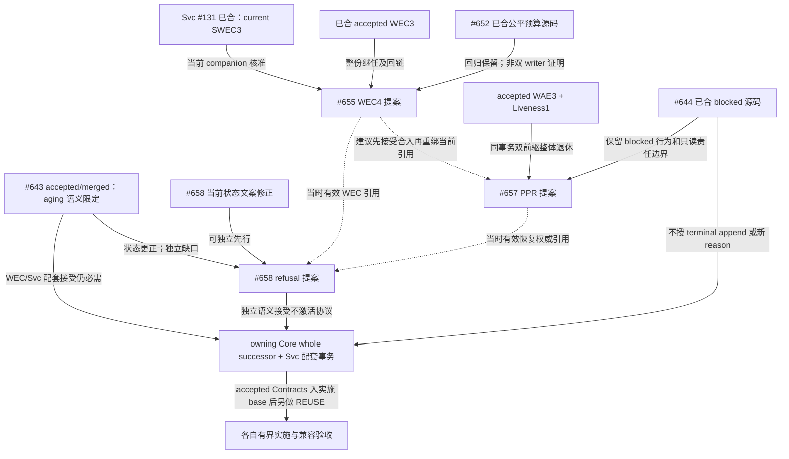

# 三 PR 权威继任顺序与冲突检查

本报告完成 Owner 裁定⑤的顺序与冲突分析，供原 PR 的合法接受事务使用；不是 Product Authority、接受事务或实施许可。**建议先独立修正 #658 的 #643 当前状态，再完成 #655 → #657 的继任协调，最后以实际有效前驱协调 #658。Svc #131 已清除原外部核准阻断。**三个提案仍未合并，本报告不修改它们、不接受、不合并、不实施。

## 1. 授权、坐标与证据

授权为本轮 [Brief](BRIEF-SUCCESSION-R2.md)、[原五项 Brief](BRIEF-SUCCESSION-ORDER.md)、Owner `owner-20261107-four-pr-rulings` ②–⑤及常设授权原 §3B。选中原文、selector 与实测 canonical SHA256 见 [R2 Owner 快照](docs/evidence/succession-order/r2/owner-rulings.json)。四 PR 裁定 SHA256 为 `677bfe608a67d67f8f9092d817fff0e4f4d040f1bc6e0a0184a69315bc54d7b7`；常设八节为 `01cc059c2bf0e0493588f00032ca06eb73e3a0a13cb33f4078996fdccb79dad3`。

实际入口是 `/private/tmp/h-succession-order`、既有本地 `docs/succession-order@9df5bd2fdea17f04bcd1762cd6800c350efcf9c3`，无 tracked 改动，保留前轮未提交 Brief、STOPPED 和证据。Brief 的 detach `2d8ce9d0` 是更早坐标；它是实际入口的祖先，不据此 reset 或改其他 checkout。远端尚无同名 branch。本次复用该隔离分支完成首次提交。

本轮 GitHub 插件 fresh-read 和 Git ref 核对见 [PR 快照](docs/evidence/succession-order/r2/pr-snapshot.json)；所有以下行号都固定于所列 SHA，后续修订须重新绑定，不把 PR body 当当前接受事实。

| 对象 | 固定 revision / 状态 | 本轮含义 |
|---|---|---|
| Core 工作面 / #643 merge | `9df5bd2fdea17f04bcd1762cd6800c350efcf9c3` | #643 提案语义 accepted 且已 merged；implementation none、production none、WEC/Svc 门仍在 |
| 当前 Core main / #660 merge | `bb67ce5ae53908c299e751d3904793b9f4d08240` | 新增已接受常设委托 Spec；本次读取其 §3/§9 原 §3B，不把它当运行控制生效证明 |
| #655 WEC4 | `a61ba45f1f168d5b755a9aa37d74f21135467ec6`；OPEN | proposed whole successor，当前实施权 none |
| #657 PPR | `d7fcc52cff01abd6990aaa6f741de8b0deb2da24`；OPEN | proposed WAE3 + Liveness1 完整后继，当前实施权 none |
| #658 RTH | `680dc594e05a823128ca0efaa5b527683b6dbf62`；OPEN | NEW、独立提案、当前实施权 none |
| #644 blocked 源码 | merge `4f7df01bcf087075c114901a96a7a54573110f61`；delivery head `8f68a94668764f957043640fa1eb23740a760a29` | 已合源码/隔离验证证据；不等于安装、启用或 live 验收 |
| #652 公平预算源码 | merge `2d8ce9d0af6a1ffcb3c8d3bdd9364635e9ae8648` | 已合公平预算修复，不证明锁外采集或双 writer 前进性 |
| Svc #131 / 当前 main | `8da8dbcb70e700d9e35970e8b662b1be2c29afdc`；MERGED | V2→V3 生命周期登记闭合，V1 历史链保留 |

当前 main 相对工作面只增加 #660 的文档事务。实测十个相关治理/Architecture/Decision/WEC3/WAE3/Liveness1/RBAH blob 均相同，见 [检查记录](docs/evidence/succession-order/r2/checks.json)。已读当前 main 的 `AGENT_CORE_STANDING_OPERATIONAL_DELEGATION_V1`；它不改变本轮 docs-only 和不合并终点。

本文缩写及路径：Core Spec 均在 `docs/specs/`。WEC3/4=`AGENT_CORE_WORKFLOW_EXECUTION_CONTROL_V3/V4.md`；WAE3=`AGENT_CORE_WORKFLOW_AGENT_EXECUTION_V3.md`；Liveness1=`AGENT_CORE_WORKFLOW_RECOVERY_LIVENESS_V1.md`；PPR=`AGENT_CORE_WORKFLOW_PRE_ADMISSION_RECOVERY_V1.md`；RBAH=`AGENT_CORE_READBACK_AGING_HANDOFF_V1.md`；RTH=`AGENT_CORE_REFUSAL_TERMINAL_HANDOFF_V1.md`；SRE2=`AGENT_CORE_WORKFLOW_STALE_REENTRY_V2.md`。accepted Core 坐标为工作面 SHA；提案坐标分别为表中 PR head。Svc 坐标均为 #131 merge SHA。

适用权威按本仓 precedence：Architecture 的系统 ownership/薄层边界；D-008 的身份与 Session 所属；D-009 的 UNKNOWN/termination/no-replay；accepted WEC3、WAE3、Liveness1、RBAH；accepted local governance/adoption V3 与当前常设委托。报告只复用这些边界，不改 stable ID 原义。

## 2. Svc 前驱核准：原停止原因已闭合

[Svc 固定文件摘录及 blob](docs/evidence/succession-order/r2/svc-authority.json) 可复核以下状态：

| Svc 对象 | 条款 / blob | 核准 |
|---|---|---|
| `SVC_WORKFLOW_EXECUTION_CONTROL_V3.md` | L4 accepted，L7 contracts，L8 production none，L19–22 supersedes V2/V1、无后继；blob `7c6c5d1de1d1f6e1a580521f01fce90f1c2de2b2` | 当前 accepted companion |
| `SVC_WORKFLOW_EXECUTION_CONTROL_V2.md` | L4 superseded，L19–21 保留前驱 V1、后继 V3；blob `e528b2f10733f48187ef88a99e696f9df0c5bed3` | 不再 parallel current |
| `SVC_WORKFLOW_EXECUTION_CONTROL_V1.md` | L4 superseded，L64–65 后继 V2；blob `200e784d16f152231d8c3c4df138a5a474672275` | 保留 V1→V2→V3 历史退休链；无需改写成 V1 直指 V3 |
| `.agents/local/README.md` / `docs/specs/README.md` | L143–163 / L48、58–59；blob `9365bc513e7296ac8a51a79fe2f0d110e2b418ac` / `0e83f18a3a4094303d10ae763c616379b652a11e` | 两索引同步，明确历史链和 current V3 |

**核准结论：Svc V2→V3 前驱核准已完成，坐标是 [Svc #131](https://github.com/mayf3/svc-workflow/pull/131)。**V3 `CTR-SWEC-010` §13 L603 起与 V2 §13 L387 起的现行条款逐字相同（只读子审直接比较，各 7268 字符）。#655 可在当前有效配对引用处改绑 V3 `CTR-SWEC-010@8da8dbcb…`；#655 自身的引用改动尚未执行。

#131 只闭合已接受生命周期。Svc V3 `CTR-SWEC-010` L610–630 仍为 closed DTO，ingress 仅 `assignee | execution_policy`，reason 仅 null、`ATTEMPTS_EXHAUSTED`、`STALE_LOOP_EXHAUSTED`；L632–646 限 current ACTIVE、非 terminal、当前 visit/assignee；L648–701 要求真实 receipt/Event/sequence provenance、只读且不产生消费记录。它没有接纳 #643 aging 或 #658 refusal 新协议。

## 3. 依赖图与关系分类

实线表示现有权威、明确的接受/实施前置或保留边界；虚线表示为减少重复迁移而建议的协调顺序。图中 future 配套事务尚未执行，不预造其 stable ID。

| 关系 | 可定位的触点 | 解释 |
|---|---|---|
| WEC3 → #655 | WEC3 CTR-WEC1-008 L222–227、259–265；WEC4 §3 L112–143、CTR-WEC4-010 L489–543 | accepted 旧语义要求远端读持锁；V4 只替换两类指定采集时序，必须 whole successor，不同 stable ID 偷改 |
| #655 ↔ #657 | PPR L21、§3.2 L82–84、§8 L185、CTR-PPR-003 L232–247；WEC4 §3 L112–115 | PPR 当前依赖 WEC3，WEC4 当前仍受 WAE3/Liveness1 约束；按建议顺序迁移有效组合引用，历史来源不改 |
| #657 ↔ WAE3/Liveness1 | PPR L23–25、§3.1 L74–78、§12 L420–434 | 新权威完整承接两份前驱；仅移除 ordinary planned 的窄禁令，不丢 inherited 合同 |
| #643 ↔ #657 | PPR §3.2 L95–97、§12 L428–430；RBAH L35–37、§3.2 L108–110 | PPR 已正确记 #643 accepted/merged；需迁移 RBAH 当前依赖，保留其独立接受和配套门 |
| #643 ↔ #658 | RTH §3.1 L70–90、CTR-RTH-004 L249–269；RBAH CTR-RBAH-004 L212–252 | 共用系统 Assistance 骨架，aging 与 refusal 的资格、reason、DTO 分别受权威约束 |
| #644 ↔ #657/#658 | PPR §2 L57–58、CTR-PPR-006 L316–320；RTH CTR-RTH-003 L211–220；#644 receipt L24–34、114–117 | blocked 自动恢复已有源码；ordinary planned、terminal append、合法交接是另外的权限边界 |

## 4. 建议拓扑及逐步效果

该顺序是本报告建议，不冒称原合同已写明 #655→#657→#658 的硬顺序。每次正式接受仍由 Owner mayf3 或原合法责任链中有记录、经核验获 §3B 委托的维护者执行；绑定真实身份权限、非作者语义审查、reviewed HEAD、最终接受事务及互斥回链。审查者、报告作者或角色名不自动获得接受权。范围内修订复用现有 PR/Spec lifecycle，不新增审批平台；本任务不执行任何接受。

| 步 | 前置 / 责任 | 原 PR 的最小动作 | 接受并合入 main 后的效果 |
|---|---|---|---|
| 0，已完成 | Svc 原合法责任链；#131 merge | V2 superseded→V3、两索引同步、V1 历史回链核验 | 外部 current companion 无歧义；不新增协议 |
| 1，可独立先行 | #658 文档作者 + 非作者差量复核 | 修 RTH §3.1 L70–72 的 #643 当前状态；保留已更正回执与历史快照 | 仅候选叙述校正，不产生新权限；无需等待 #655/#657 |
| 2，#655 | 步0；Owner④既定两类时序与现有实施权要求 | 重绑 current Svc V3；统一 accepted Contracts 承接；独审后 WEC3→WEC4 whole-authority 接受、旧权威退休、双向回链和索引 | current WEC4；只授权正式 accepted 合同内源码工作，production none；双 writer 证明仍必做 |
| 3，#657 | 步2若采用本顺序；Svc 原阻断已清 | 当前引用改绑 actual accepted WEC4；同事务整体退休 WAE3 + Liveness1；迁移依赖载体；统一 contracts 实施权；独审与最终接受复核 | current PPR 完整接管两前驱；原 blocked 保留；ordinary planned 仅新 closed-proof 类可首次 admission；不激活 aging/refusal |
| 4，#658 限定语义接受 | 步1；与届时实际 current WEC4/PPR 协调 | 修当前 governing/primary-parent 引用；独审并完成 NEW 提案的限定语义接受 | refusal 语义 accepted；仍 `implementation_authority:none`、`supersedes:[]`；不实施新协议 |
| 5，后续原责任链 | #643/#658 的正式配套门 | 面向当时 current WEC 与恢复权威走完整 owning Core successor、Svc 配套合同与各仓接受事务；不从已退休前驱再分叉 | 仅在精确配套 accepted/main、实施 base 包含且合法任务完成 REUSE 后，才有对应协议源码实施资格；安装/启用另核 |

#658 独立提案语义接受在引用无歧义时可独立办理；推荐放在步3之后是为了避免再迁移一次。它不是 #655 或 #657 的必备前置。Svc 生命周期闭合也不等于 Core 双前驱已经退休；后者仍是步3原 PR 的待执行事务。

## 5. 冲突扫描与最小消解

本轮未发现阻断报告发布的未消解 accepted authority 冲突。以下是固定提案的已识别接受前待修/实施门，不能据此把提案报为可按原字节接受，也不由本报告替它修订 accepted 意义。

| ID / 冲突面 | 具体证据与可达反例 | 最小消解 / 剩余门 |
|---|---|---|
| C1，Svc 引用过期 | WEC4 L21–25、§3 L126–143、L834 仍指 V2；Svc #131 后 V2 已退休 | current 配对改为 V3#CTR-SWEC-010@8da8dbcb；§5 L172–181 的旧 OBS-WEC4-002@d4c510d9/V2 保留，另增当前核准 Observation。外部核准 DONE，提案更新 TODO |
| C2，whole successor 意外冻结实施权 | WEC4 L7、35–39、139–143、236–237、ACC-WEC4-001 L654–656、接受示例 L783、L817；PPR L6、32–34、§12 L424/434 仍把 accepted 后设 none；Owner②④要求承接正式合同实施权 | 在各原 PR 的合法接受版本统一 frontmatter、当前 lifecycle/验收/接受示例为 contracts 承接，保留 authoring 历史含义；production none。报告不激活、不把 proposal 当前 none 改报 contracts |
| C3，同一旧前驱重复分叉 | #655 拟退休 WEC3；PPR/RTH 仍把 WEC3 当 current；PPR 拟退休 WAE3/Liveness1 而 RTH 仍引用它们 | 按 actual accepted/main 的 current owner 迁移有效组合层与索引；固定历史附录/OBS/hash 原字节保留。后续 whole successor 从有效 WEC4/PPR 出发，不再次退休旧权威 |
| C4，双前驱或 scoped effect 遗漏 | PPR §12 L426–430；Liveness1 frontmatter L23–27、§8 L168–170；RBAH 当前依赖；ASM 两种类型/来源关系 | 同事务整份退休 WAE3 与 Liveness1；迁移 index、ASM two-kind/backlinks、SRE scoped-effect carrier、RBAH 依赖。SRE2/RBAH 保留独立权威，不退休整份；历史接受不抹除 |
| C5，锁时序混成恢复放行 | WEC4 CTR-WEC4-010 L489–543；PPR CTR-PPR-003 L232–258 | WEC4 仅两类指定 pre-plan/Owner-resume 远端采集外移；不泛化 recoverAttempt 或其他 PPR gate。重新取同锁、fresh replay、可信外部身份/版本最终检查和原 WAL/消费顺序保持；不解锁所有 planned |
| C6，#643 当前状态误述 | RTH §3.1 L70–72 仍写 proposed/未合并；同 head RECEIPT-REFUSAL-PROPOSAL L50–59 已更正；#643 main 限定接受事实明确 | 只修活跃正文：语义 accepted/merged，implementation/production none，WEC/Svc 门在。保留回执更正和历史 source provenance；PPR L95–97 已正确，无需重复修 |
| C7，reason/DTO 错误合并 | RBAH CTR-RBAH-004 L242–252 请求非空 policy reason 三值；RTH CTR-RTH-004 L260–268 保留旧 active DTO、CTR-RTH-006 L310–316 禁 refusal resume；现 Svc V3 仍仅两 reason | 区分系统 create schema、交接回执/history DTO、active resume evidence、resume eligibility。aging 的三值事实读回仍须配套接受；refusal 走专用 handoff/history，不塞入 active DTO。RTH 的“两旧 reason”措辞须与届时 aging 接受状态协调，不回退合法三值，更不统一放宽为四值；两个新 reason 都不成为 resume permit |
| C8，terminal/historical 边界扩大 | RTH CTR-RTH-002 L188–207、003 L211–220；现 Liveness1 CTR-EKRWAE-003 L201–216 只给 B1/B4 terminal metadata 窄例外；#644 ACTIVE 预存 cadence 后 terminal 只读 | B2 terminal handoff append、历史/closed/discrepancy-only 请求要由 owning Core whole successor + Svc 配套正式承接。旧 reason 和 aging 的 current/nonterminal 条件不随 refusal 一起放宽；原 tuple 与 assignee 不等双份事实必须证明；不冒充 assignee |
| C9，源码/责任活性冒充交接或业务完成 | #644 automatic.js L56–64、refusal.js L5–22/62–80@8f68a946；RTH CTR-RTH-005 L273–306 | 预存 cadence 和 `REFUSAL_RESPONSIBILITY_PENDING`/UNKNOWN 不授 terminal append，不等于 HANDED_OFF。须真实服务回执→合法接收→后续消费者→答复验证→再触发；ACK/case/resolve 不证明业务完成、不 mint generation、不清 UNKNOWN/fence |

C2/C3/C4/C5 的接受事务须独立审查修订差量及直接受影响依赖；已有未变产品证据不重跑。若执行时出现新的 accepted 权威冲突、不可核准配对、实际门失败，停止对应动作并追加 STOPPED，记录来源、反例、影响与最小闭合；不以报告建议替代接受者判断。

## 6. 前驱核准清单

`DONE` 仅表示本轮确已核准的事实；`TODO` 属未来原 PR 接受/实施任务，本报告没有执行。

| 项 | 状态 | 精确坐标 / 修正内容 | 完成责任与证明 |
|---|---|---|---|
| P1，Svc V2→V3 | DONE | #131@8da8dbcb；本报告§2五个 blob、双索引和 V1 历史链 | Svc 原责任链已合并；本轮插件与子审 fresh 核准 |
| P2，#655 current companion | TODO；前置 P1 DONE | WEC4 L21–25、126–143、834：V2→V3#CTR-SWEC-010@8da8dbcb；L172–181 历史 OBS 不改 | #655 作者修 current 层，独立差量复核绑定最终 SHA |
| P3，#655 实施权 / whole retirement | TODO | C2 全部当前权利/验收点统一；WEC3 整份退休→WEC4；reciprocal backlink/current index 同事务 | 原合法接受者 + 非作者最终复核；production none |
| P4，#657 双前驱 | TODO；外部阻断清除 | PPR L23–25、74–78、420–434：WAE3 与 Liveness1 同事务整份退休、后继 PPR | 两份旧 authority 状态/反链、PPR supersedes 双项、独立最终接受检查 |
| P5，#655/#657 引用协调 | TODO | PPR L21、82–84、185、232–247：若 #655 已合，当前组合层重绑 actual WEC4；历史附录 A/B 不改；#655 中 current WAE/Liveness 依赖按新 current owner 协调 | 原 PR 作者/接受者，记录精确 main revision 和条款，不按“最新版”猜 |
| P6，current 消费者迁移 | TODO | PPR §12 L428–430；ASM current/source carrier、SRE scoped-effect carrier、RBAH L35–37/108–110；保留 SRE2/RBAH 权威 | current index/pointer/backlink 无平行 current；历史来源仍可追溯 |
| P7，#657 实施权 | TODO | PPR L6、32–34、424、434、CTR-PPR-006 L319–320：accepted Contracts 入 base 后另任务 REUSE，不能 whole successor none 冻结 inherited 权限 | 原接受版本与独审覆盖；本轮仍 proposal none |
| P8，#643 状态表述 | TODO，独立可先行 | RTH L70–72 修 accepted/merged 限定；回执 L50–59 已正确，保留；PPR L95–97 已正确 | #658 当前正文修正与差量复核，无须重做 #643 接受 |
| P9，#658 有效前驱 | TODO | RTH L18–20、80–84、§13 L372：面向届时 current WEC4/PPR，保留 source snapshot；不预造后继 ID | #658 限定语义接受与后续整权事务分别绑定 |
| P10，aging/refusal 配套协议 | TODO，独立实施硬门 | RBAH §3.1/CTR-004/006、RTH §3.1/CTR-002..006、Svc V3 CTR-SWEC-010 | owning Core whole successor + 精确 Svc accepted/main；逐 reason 兼容、收据/读回/消费者/答复验收，不由 #131/#655/#657 自动关闭 |

## 7. 实施闸门矩阵

下表为接受后的条件化能力，不声称这些接受、实现或测试已经发生。源码实施须相关 accepted implementation-authorizing Contracts 在实际实施 base 中，并有合法任务；production apply 与安装/启用仍分开核验。常设授权不使未执行门成为 PASS，也不在此签发 W7。

| 对象 / 接受状态 | 可实施或准备的精确范围 | 仍闸 / 必需证明 | 本轮事实 |
|---|---|---|---|
| 已合 WEC3/WAE3/Liveness1 + #644 | 已接受合同内的 blocked 同 attempt pre-admission、安全只读对账/责任活性；复用已合源码证据 | ordinary planned 正向恢复仍排除；terminal 后只读责任不授 B2 append/新 reason/closure；安装启用和业务见证另核 | 源码已合；本轮产品测试 NOT_RUN，运行/业务 UNKNOWN |
| #655 当前 proposal | docs 修订、配对核准、独审/接受准备 | 原字节 none 不授新实现；需先完成 P2/P3 | 本轮未改提案；未接受 |
| #655 合法 accepted/contracts/main 后 | 两类指定远端采集外移；重新取原锁、replay 当前 durable ledger、锁内 fresh 权威身份/版本校验、原顺序 commit；其他合同原样承接 | **实际双 writer + 隔离真实持久 ledger/OwnerLock 是硬门**；并发/崩溃/重启和 stale 负例须证实；production none | 双 writer NOT_RUN，性能收益 UNMEASURED |
| #657 当前 proposal | 双前驱/引用/实施权协调、独审/接受准备 | 当前 none 不授权 planned 新类；Svc 闭合不代替 Core 双前驱退休 | 本轮未改提案；未接受 |
| #657 合法 accepted/contracts/main 后 | inherited blocked + 可信 original producer/WAL closed proof 的 ordinary generation=1 首次 admission；同原身份、同 request/attempt/generation/baseline，通过全部 fresh gate 后继续 | 仅正常 due-feed ACTIVE/planned，非 Owner/stale 来源；proof 与原 plan 同次 durable append，禁止事后补；正面零投递/never-invoked、从未启动工具、可信授权/world/version/锁内 replay/CAS/WAL 顺序；UNKNOWN/delivery-domain/legacy 无证明全部拒绝；production none | proof/多 writer/故障/兼容产品验收 NOT_RUN |
| #658 独立语义 accepted/main 后 | 后续 docs-first owning whole successors、Svc 配套设计和既有授权准备 | **不实施新协议**：新 reason producer、B2 terminal append、historical/closed/discrepancy-only case 与 history inbox/detail/action 尚无许可；implementation none、production none | 仍 proposed；本轮零协议实施 |
| #643 已 accepted/merged | 保留 aging 限定语义，准备 owning WEC/恢复权威及 Svc 配套 | implementation none；未有配套接受不得实现新 reason；三值 DTO 仅事实读回、不产生 resume permit；生产 none | 接受已核准；配套门 OPEN |
| #643/#658 各自完整配套 accepted/main 后 | 在新任务 REUSE 下，按各自 accepted Contracts 实施系统 actor、closed schema、同 ledger、幂等收据/读回、接收/答复/再触发 | 两 reason 分别资格、分别兼容验收和启用；旧 binary 安全拒绝/保留责任、历史 case 可发现与合法答复、持久重启故障链须实际证明；不冒认 assignee、不重开 attempt、不推断业务完成 | future 门未执行，不声称四 reason 已可实施 |

双 writer 的最小实测安排来自 WEC4 `CTR-WEC4-010` L489–543、`ACC-WEC4-003` L676–691：分别令 writer A 在真实 pre-plan 和 Owner-evidence 远端 collection 等待处停于 barrier；独立真实 writer B 共享**隔离持久** ledger/OwnerLock，必须在释放 A 之前完成无关合法推进；同时记录锁获取/持有、fresh replay、持久行、消费/投递数和最终 validation 的等待时间。再按 `ACC-WEC4-004/005` L693–728 检查本地/外部 stale、同 visit/case 竞争、崩溃重启。静态审查、mock-only 或 #652 公平预算测试不能替代该证据。此硬门约束后续实施/效果签结；本次 docs-only 没有运行它。

PPR `CTR-PPR-001/003/005`、`ACC-PPR-002..005` L340–388 的真实持久 store/进程故障/同计划多 writer、新旧 producer/reader 兼容及 actor/closed-schema/交接负例仍待对应实现任务执行。RTH 的 receipt→接收→后续消费者→持久答复验证→再触发链也未运行。技术检查、调用 ACK、源码合并、安装、实际启用和业务见证各列，不互相代替。

## 8. 本报告交付边界与下一动作

本轮五项报告已形成：§3 依赖图、§4 顺序、§5 冲突消解、§6 前驱清单、§7 实施矩阵。原 Svc 停点的历史原文保留，R2 闭合追加到 [STOPPED](STOPPED-SUCCESSION-ORDER.md)；执行检查、独立审查、实测 hashes 与发布状态见 [RECEIPT](RECEIPT-SUCCESSION-ORDER.md)。报告检查 PASS 只证明本次 docs 交付，不是三提案接受或产品/生产验收。

本任务终点为 commit/push `docs/succession-order` 并开 base-main PR，**不合并**。后续可执行动作是由原责任链在 #658 做 P8 当前状态修正，在 #655 做 P2/P3 接受准备，再按选定顺序处理 #657；不用重复请求 Owner 已决定范围的授权。若后续事实或权威变化，只重检受影响差量和依赖。
