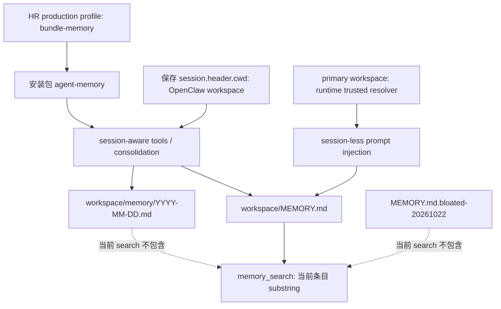

# HR 记忆实际链路核查（2026-10-21）

状态：READ_ONLY_INVESTIGATION。仅证据与设计依据，不是 implementation / production acceptance。

本轮用户要求：核实 HR 实际读写与检索链路，提出 `memory.inspect`、历史检索、幂等归并的具体 Spec 和实施计划；不改生产、不覆盖原记忆。观察截止 2026-10-21T14:45:50Z（北京时间当日 22:45）。运行中的文件可能继续变化，本文哈希是各次保存快照，不能冒充所有文件的同一原子快照。

## 1. 结论与证据强度

| 问题 | 本轮结论 | 能证明 / 不能证明 |
|---|---|---|
| HR 使用哪个 workspace？ | 保存的 main 和最近一个 cron session header 的 `cwd` 均为 `/Users/yanfenma/.openclaw/groups/workspace-oc_a5e904510bbf4b983d6cd97b9f7bbb74` | 是实际 session 持久记录；不是当前所有进程的环境证明 |
| memory 插件是否配置？ | HR 实际 production profile 包含 `@agent-core/bundle-memory`；patch 配置 agent-core-memory；包链接指向安装目录 | 证明磁盘配置和解析目标 |
| 模型是否拿到记忆工具？ | 两份保存 request/header 都列出六个 `memory_*` 工具 | 证明这些保存请求的工具注册；本次两份日志未发现实际 memory tool/call |
| 自动注入是否已实证？ | 保存的 system 字符串未见安装源码使用的 `[memory] cross-session long-term memory of this agent:` 标记 | 不得据此断言禁用：尚未证明该保存字段包含最终所有 prompt context；当前注入成功仍 UNKNOWN |
| 实际内容是否在继续写入？ | 当前 MEMORY.md 从前一快照 2,849B / 6 条增至 10,388B / 24 条；新增分批各 3 条，Source 均标为 main consolidation | 是文件变化与来源标签实证；没有将标签升级为具体 OS writer/PID 因果证明 |
| 搜索会查旧归档吗？ | 安装源码 `search()` 只 load 当前 MEMORY.md 后做 substring search | 归档和 daily notes 不属于当前 memory_search 的 corpus；本轮未运行真实检索 |
| 原 runtime memory 路径是否还在？ | `/Users/authsvc/.agent-core/workspaces/agt_hr-agent/memory` 返回 ENOENT | 仅该路径的本次结果，不代表 imported workspace 记忆丢失 |
| 是否核实当前加载字节？ | 未核实 | 包 symlink、磁盘哈希、进程 entry 都不是 loaded-module attestation |

## 2. 实际链路

安装源码坐标均以观察到的安装版本为准，不混用 checkout 行号：

- `src/index.js:196–205`：工具/归并使用 `session.header.cwd`，缺失则 fallback 到 plugin primary workspace。
- `src/index.js:236–277`：load/search/list 只读这个 workspace 的 MEMORY.md；update/remove 重新 load 后全量写回。
- `src/index.js:331–351`：归并把模型输出 Source 强制设为 `consolidation:session:<session.id>`。
- `src/index.js:547–569`：提取直接 user message 与 assistant message 文本，最多 40 条；过滤非 user 来源的 user event。不读取 injected context 作为独立事件，但 assistant 对旧记忆的转述仍可能进入证据。
- `src/index.js:573–609`：turn/end 调度；watermark 只在 Map 内，且在定时任务成功落盘前推进；running 集合按 session，而非 workspace。
- `src/index.js:644–657`：自动注入同步重读 primary MEMORY.md；异常记录后返回空字符串。
- `src/memory.js:462–481`：仅 `type + title.trim()` 相等即合并，直接采用新 content；没有持久证据去重或冲突证明。
- `src/memory.js:503–510`：大小写不敏感 substring 检索 title/content/tags。
- `src/memory.js:521–540`：默认注入最多 6 条 / 2,400 个 JS 字符；不是 token 数，也不是总文件预算。
- `src/memory.js:543–568,592–648`：daily notes 是 append；consolidate 先记 daily，再蒸馏、读 core、全量写；两者和 checkpoint 没有共同持久事务。

安装目录：`/usr/local/libexec/agent-core/app/packages/agent-memory/`。上面各调用只做了源码读取，没有调用 plugin apply / load / consolidate / tools。尤其 apply 会 mkdir（index.js:220–221），不能拿 mount 当作只读 inspect。

## 3. 路径与版本的实证

### 3.1 配置与保存请求

- Registry `/Users/authsvc/.agent-core/agents.json`：17,970B，SHA256 `e0800b0fde6fc46b2873decd0f83c9b807b48b56cc3c9ad9cf578a5685b5b6fe`；仅投影 HR `{id:agt_hr-agent,disabled:false}`，未导出其余 agent 数据。
- HR `profiles/agent-core-production/package.json`：836B，`c717eb0a6aac315be6e7d7baf743b19368bd628fd3372af8ebd576bb2d9bb06c`；包含 bundle-memory。
- 同 profile `cordis.patch.yml`：2,337B，`2a07dfdabf484007f3a0276505a6fff4126d68180d0dd39ef1a84dce1861670a`；memory workspaceRoot 来自 `DSH_MEMORY_WORKSPACE_ROOT`，session 持久目录为该 DSH home 的 sessions。
- `profiles/node_modules/@agent-core/agent-memory` 是指向上述安装包的 symlink。
- 安装 compose.js:155–161 / 176–202 把 layout workspace root 和可选 primary-workspaces map 交给 bootstrap。实际 map `/Users/authsvc/.agent-core/primary-workspaces.json` 本次读取 EACCES；未重试、未改权限、未寻找替代文件绕过。

保存 session 根为 `/Users/authsvc/.agent-core/homes/agt_hr-agent/sessions/--Users-yanfenma-.openclaw-groups-workspace-oc_a5e904510bbf4b983d6cd97b9f7bbb74--/`。只枚举一层名称，选择 main 与最新 cron，各读取不超过 2MiB；没有扫描全部 1,008 个 session 目录。

| 相对路径 | 完整稳定快照 bytes / SHA256 | 实际读取范围 |
|---|---|---|
| `main/session.jsonl` | 1,121,107 / `bfa7529ce3c250820e61f0e34967d2fde098d51f2849f3a1659264e417e57372` | header cwd、事件种类、工具名称；无 transcript 原文导出 |
| `cron-run-occ~003A07120c2962f1cdb1/session.jsonl` | 644,454 / `b457c04bf0d0e2fa329a59421ff4fe926f3c3db0e832630ce1ac5d291c196042` | 同上 |

最后补核 injection marker 时 main 已追加，读取快照 SHA 为 `c267a29c8b1a7514d87ca2a6c9e55b8a7d8cb8c7c8fe7f6abc230ddfb0051837`；该次未独立保存 bytes / 稳定 bookend，不与前一快照混绑。两份日志保存 system 字符串长度均为 4,646，SHA `f8d1a8e26af3b196e567bc479b7fa8a7701152f548dc09d2f58bffb9c67b7b7f`，未含安装源码 memory marker。没有导出 system 正文。

进程快照曾观察到 production-runtime entry 的 UID0 / UID505 进程，稍后相同 PID 集合已不再出现。没有读取子进程 env，没有定位到可证明的当前 HR loaded generation；不追逐进程、不发送探测消息。connector 的一次只读 resolve 请求返回 HTTP429，未产生 agent mapping，未循环重发。

### 3.2 文件增长与归档

| 文件 / 快照 | bytes / 条目 | SHA256 |
|---|---:|---|
| 保留原件 `MEMORY.md.bloated-20261022`，前一轮完整统计复用 | 2,112,509 / 5,337 | `537b40d62731536e58ec66853e2e24a656098370716c52e281c31cef44919a03` |
| 当前 MEMORY.md，较早快照 | 2,849 / 6 | `25e6b9177df755d1bb970f5a42232f8194aeb2ae82ea7cf100884c1e71b29625` |
| 当前 MEMORY.md，本轮稳定快照 | 10,388 / 24 | `357c4d0637c6cb6308fafc68b7f646d534e70b1289851f2867ec3a739c744cab` |
| `memory/2026-10-21.md`，本轮稳定快照 | 329,725 / 未作语义条目计数 | `aaba32690e2ee32f27806d12bba423d3ce94dc8a61c4dce9423492421acda91f` |

原归档前一轮统计有 5,177 条 consolidation Source 标签（约97%），cron 标签 3,456、main 1,546；归一化正文完全相同的冗余条目 99，不代表其余条目全部语义独立。当前文件的 24 条全部标 main；14:29、14:35、14:36、14:38、14:39 的若干时刻均各新增 3 条。源码 `DISTILL_PROMPT` index.js:123–131 明确要求每次提取 2–3 条，这是增长压力的直接代码机制；不能仅凭时间相关性认定单一根因或特定进程。

Imported workspace 的 memory/ 有 135 个直接成员，除了日期 Markdown，还含 dispatcher JSON/JSONL。历史搜索不能简单递归读整个目录。本轮没有展开这些非日期文件。

### 3.3 已安装修复不能被旧 checkout 覆盖

| 安装源 | bytes | SHA256 |
|---|---:|---|
| `src/index.js` | 28,676 | `691371f0b2b4036d7d6ec6365501541b150d22dedc10e63d7257865058fde20f` |
| `src/memory.js` | 27,874 | `99d59bdeb055e18d7827d5529f2505783252e6b75124f8fb45c91d5a96bf2b7d` |
| `src/paths.js` | 3,777 | `d0db84ad9ea5a5c93fbe7ea474b83b3c332795b87b61d76e6def215313a97d1b` |

安装 memory.js 已有 Source 字段反转义、字段/内容/渲染保护、fsync 与 mode/uid/gid 保持。checkout 的对应模块仍是较早实现。安装源码描述历史 Source 重复转义可指数放大字符串；本轮只确认修复代码存在，没有复现崩溃，不能把它直接当成当前 2.1MB 文件的全部成因。

异步 load 先 stat 再读；同步 load 是 readFileSync 后才检查 bytes，不得声称两个分支都已在分配前限流。写入的 rename/fsync 也不等于多写者 compare-and-swap 或多文件事务。未来实现必须保留现有修复，并补正确的有界读取与并发契约。

## 4. 设计判断

1. **短文件只是止损。** 原先 1.7KB/只留最近三条不是持久治理策略，且当前已继续增长。
2. **历史在盘不等于能召回。** 保留归档有利于恢复，但现 memory_search 没有对应入口。
3. **重复处理与语义重复要分开。** evidence/event 去重可以严格证明；“内容相似”不能直接授权覆盖旧事实。
4. **先解决可观察性。** 当前配置、工具注册、自动注入、实际写入 actor 是不同证据层。inspect 必须输出分层状态和 UNKNOWN。
5. **保留 file-first。** 继续以当前 MEMORY.md 为 curated 内容权威，日期笔记/指定归档为历史证据。第一批采用有界文本检索，不引入向量服务、图数据库或第二个可写事实库。
6. **写入先事务化，再节流与晋升。** 同 workspace 串行、持久 event receipt、零条结果、冲突保护和总量预算共同解决复发；只有改 prompt 不足够。

## 5. 交付与边界

- proposed Spec：[`AGENT_MEMORY_INSPECT_HISTORY_IDEMPOTENCE_V2.md`](../specs/AGENT_MEMORY_INSPECT_HISTORY_IDEMPOTENCE_V2.md)。
- supporting implementation plan：[`2026-10-21-agent-memory-inspect-history-idempotence.md`](../superpowers/plans/2026-10-21-agent-memory-inspect-history-idempotence.md)。
- 当轮未改 runtime/source/config、未执行测试/迁移/工具调用、未覆盖 MEMORY 或归档、未调用生产 Agent。仅写这组审阅文档。
- 不复用旧 B7 技术角色来自动接受新 memory Spec；提案走仓库原 Spec review/acceptance，一份接受范围内按计划推进，不为每个字段加人工审批门。
- 本轮 EACCES 与未观察到的 loaded/injection 事实仍保留。后续 inspect 可在本来持有 trusted runtime context 的原进程内报告，不为填字段新读秘密或改变 UID。
